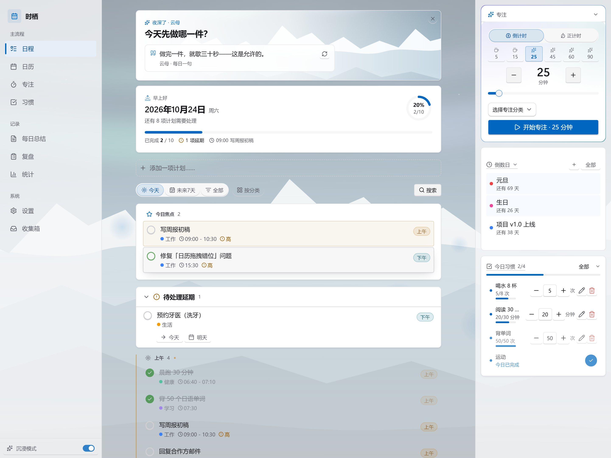
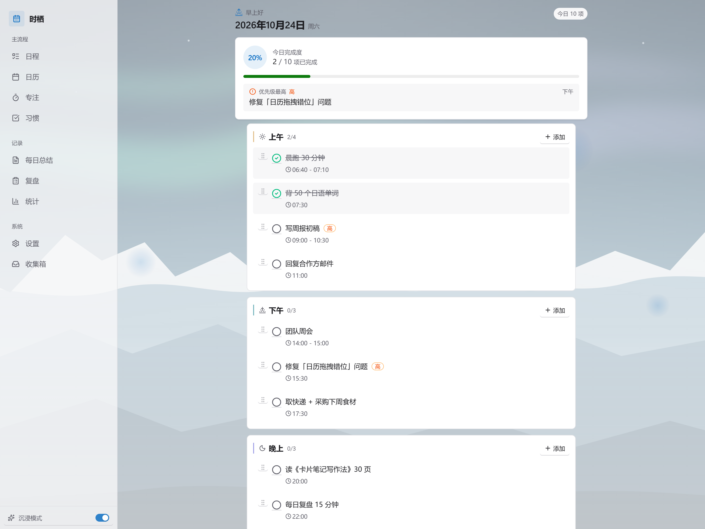
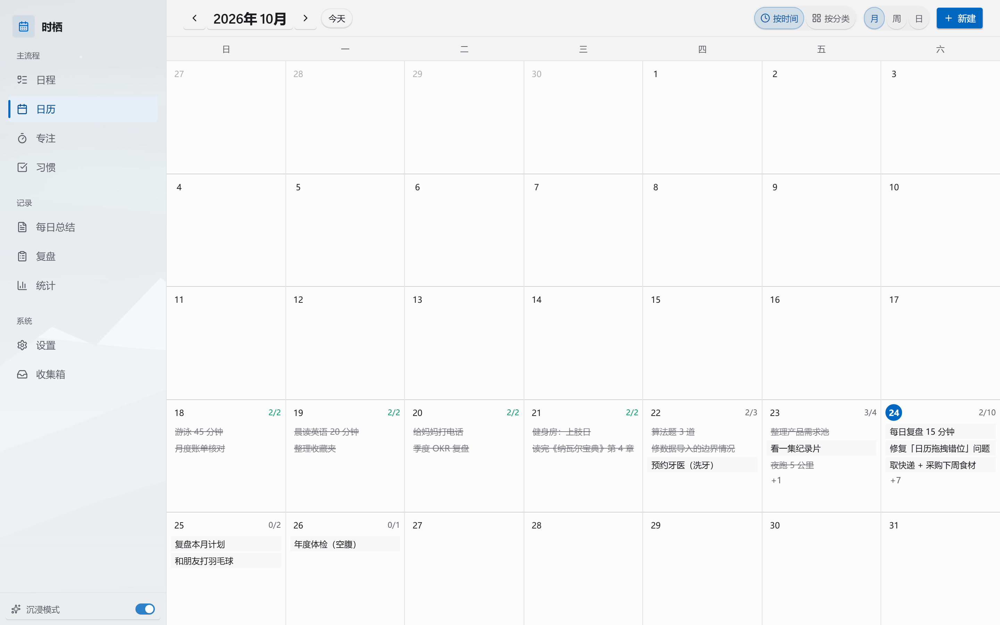
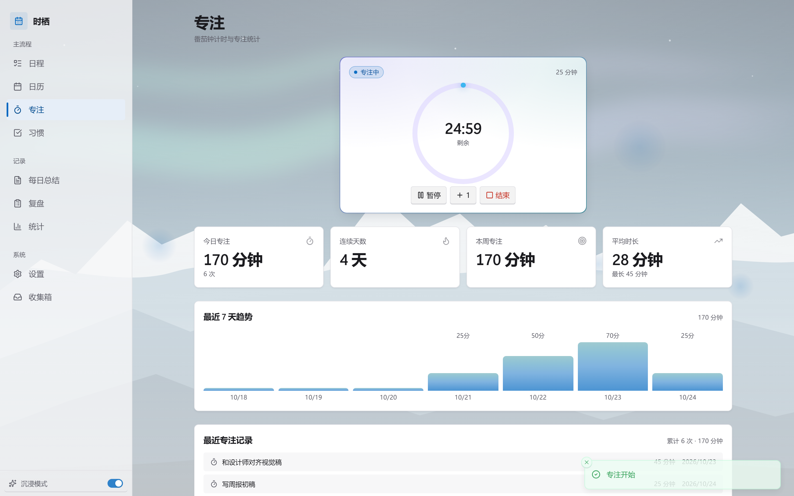
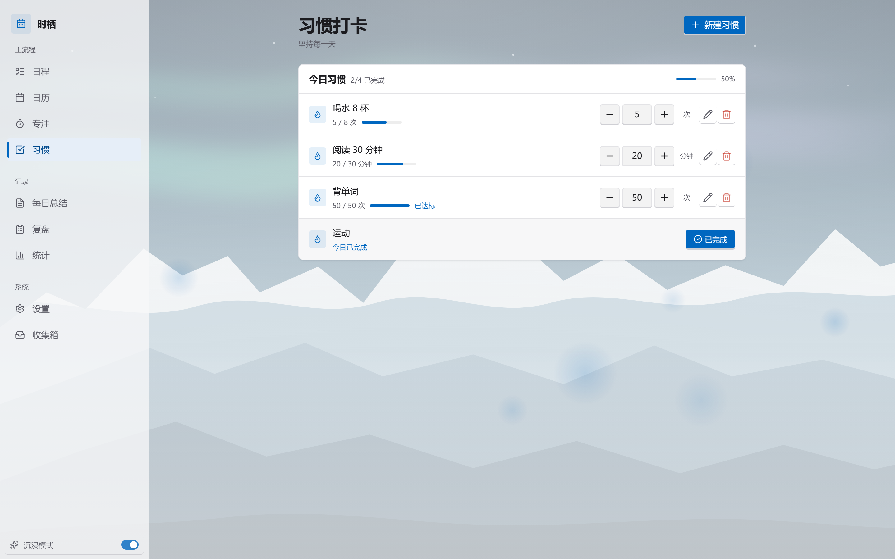
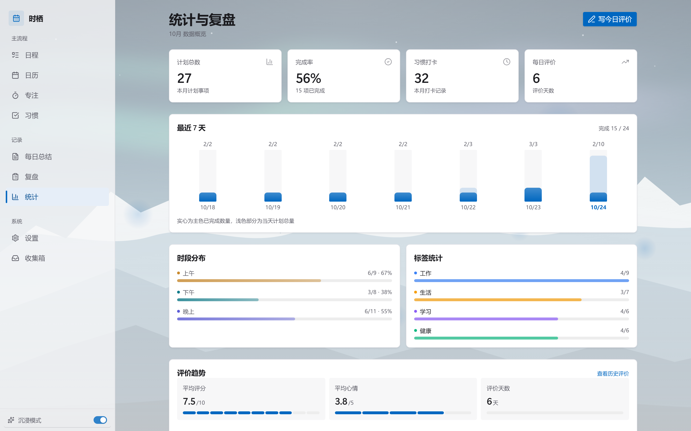
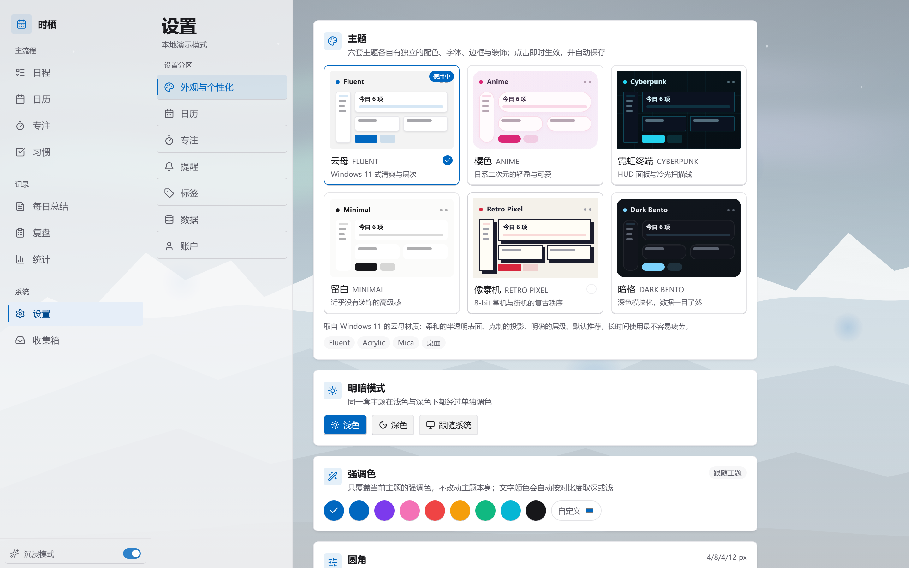
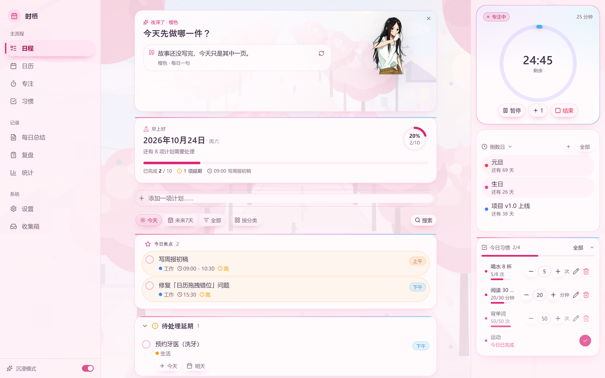
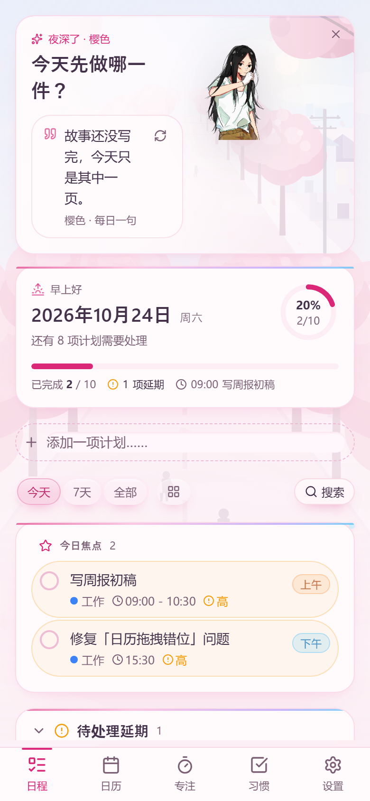
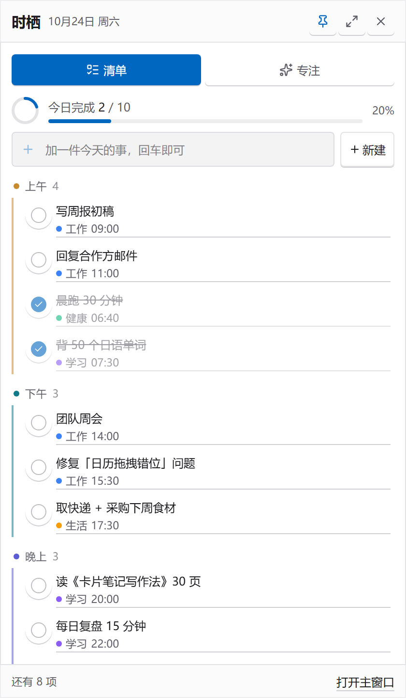

<div align="center">


# ShiQi（时栖）— Open-Source Daily Planner & Habit Tracker

**把一天分成上午 / 下午 / 晚上三个时段来安排**：日程计划 · 日历 · 待办清单 · 习惯打卡 · 番茄钟 · 每日复盘

Plan your day in morning / afternoon / evening blocks — calendar, to-do list, habit tracker, Pomodoro timer & daily review, all in one offline-first app.

[](https://github.com/2016469520/shiqi-daily-planner/releases/latest)
[](LICENSE)
[](#-下载)
[](#%EF%B8%8F-从源码构建)

**本地优先 · 无需联网 · 无需账号 · 数据完全属于你** — Offline-first, no account, no server required.

[📥 下载安装](#-下载) · [✨ 功能特性](#-功能特性) · [📖 中文使用说明](#-中文使用说明) · [📖 English Usage](#-english-usage)

</div>

---



## 📥 下载

到 **[Releases](https://github.com/2016469520/shiqi-daily-planner/releases/latest)** 页面下载最新安装包（v1.1.1）：

| 平台 | 文件 | 说明 |
|---|---|---|
| **Windows** | [`ShiQi-1.1.1-windows-portable.exe`](https://github.com/2016469520/shiqi-daily-planner/releases/download/v1.1.1/ShiQi-1.1.1-windows-portable.exe) | 便携版，双击即用；不写注册表、不需要管理员权限 |
| **Android** | [`ShiQi-1.1.1-android.apk`](https://github.com/2016469520/shiqi-daily-planner/releases/download/v1.1.1/ShiQi-1.1.1-android.apk) | Android 7.0（API 24）及以上；首次安装需允许「安装未知来源应用」 |

> 两个版本都是**完全本地**运行：不依赖任何服务器，数据保存在本机应用数据库里，不需要注册账号、不需要联网。

## 🖼 界面一览

| | |
|---|---|
|  |  |
| **今日视图** — 日视图 + 每日评价 + 习惯打卡 | **日历** — 月 / 周 / 日三种视图，拖拽调整 |
|  |  |
| **专注** — 倒计时 / 正计时番茄钟 | **习惯** — 完成 / 次数 / 分钟多种计量 |
|  |  |
| **统计** — 完成趋势 / 时段分布 / 评分曲线 | **外观** — 六套完整主题 + 个性化 |
|  |  |
| **沉浸氛围** — 场景、每日一句与看板娘 | **手机版** — 响应式布局 + 底部导航 |
|  | |
| **桌面浮窗（Windows）** — 常驻桌面的小清单 + 番茄钟 | |

## ✨ 功能特性

**📅 日程与待办**

- **三时段计划**：把一天分成上午 / 下午 / 晚上安排事项，快速输入框一行添加
- **月 / 周 / 日日历**：三种视图自由切换，拖拽排序、跨日期跨时段移动
- **重复日程**：每天 / 工作日 / 每周 / 每月 / 每年，支持间隔与结束条件
- **收集箱**：先记下没有日期的想法，再一键安排到今天或明天
- **子任务 · 优先级 · 预计用时 · 事项模板 · 延期批处理**
- **搜索筛选**：`Ctrl+K`，按关键词 / 状态 / 优先级 / 标签 / 日期范围筛选

**✅ 习惯与复盘**

- **习惯打卡**：完成 / 次数 / 分钟 / 小时 / 自定义数值多种计量方式，连续打卡统计
- **每日评价**：评分、心情、精力、总结、明日规划
- **复盘记录**：评价月历 + 时间线，历史浏览与筛选
- **倒数日**：纪念日、截止日、生日倒计时，支持每年重复与首页置顶

**⏱ 专注与效率**

- **番茄钟**：倒计时 + 正计时双模式，1 分钟粒度微调，预设 5/15/25/45/60/90；倒计时结束系统提醒，正计时每 30 分钟提醒休息
- **桌面浮窗**（Windows）：常驻桌面的迷你清单 + 番茄钟，与主窗口实时同步；支持贴边隐藏——拖到屏幕边缘缩成小条，鼠标一碰弹回
- **桌宠**（Windows）：浮窗变身宝儿姐（一人之下），左键问她问候 / 今日剩余任务 / 专注进度，右键换形态、开浮窗、开主窗口
- **专注统计**：专注时长记录，自动累计到事项的实际用时

**📊 统计与数据**

- **数据图表**：最近 7 天完成趋势、时段分布、标签分布、评分趋势
- **完整备份**：一键导出 / 导入 JSON，在 Windows 与 Android 之间搬运数据
- **本地优先**：数据存本机（IndexedDB），不上传、不联网

**🎨 外观与氛围**

- **六套完整主题**：云母 Fluent / 樱色 Anime / 霓虹终端 Cyberpunk / 留白 Minimal / 像素机 Retro / 暗格 Bento — 每套独立的配色、圆角、底纹、动效
- **深度个性化**：强调色、四类圆角、界面缩放、字体字号、动画强度，可保存命名预设
- **沉浸氛围**：原创场景插画、每日一句、开场页、任务完成彩带
- **看板娘**：随包附带《一人之下》冯宝宝六态立绘，点击说话、右键换表情；支持导入自己的角色包
- **深色模式**：浅色 / 深色 / 跟随系统；响应式布局，桌面与手机都好用

## 📖 中文使用说明

### Windows

1. 下载 `ShiQi-1.1.1-windows-portable.exe`，双击直接打开，无需安装。
2. 关闭主窗口只是收起到系统托盘（右下角），浮窗保留；**完全退出**请用托盘图标右键菜单的「退出」。
3. 启动后会出现主窗口 + 右下角桌面浮窗两个窗口：
   - 浮窗有「清单 / 专注」两个标签页，可以直接勾选完成、添加事项、开番茄钟；
   - 浮窗默认置顶，可拖动、可缩放，位置尺寸会记住；
   - 主界面侧栏底部有「桌面浮窗」开关，托盘菜单也可以随时显示 / 隐藏；
   - 设置 → 桌面浮窗与桌宠：可开启「贴边隐藏」（拖到屏幕边缘缩成小条）和「桌宠模式」（浮窗变身宝儿姐，左键说话、右键菜单）。
4. 数据默认存在本机；**换电脑或重装前请先备份**：设置 → 数据 → 完整备份 → 导出 JSON，在新设备用「从备份恢复」导入。

### Android

1. 下载 `ShiQi-1.1.1-android.apk` 传到手机，点击安装（微信 / QQ 传文件时选择「用其他应用打开」→ 安装包）。
2. 首次安装需允许「安装未知来源应用」。
3. 数据保存在应用本地；换手机前同样先在 设置 → 数据 里导出备份 JSON，再到新手机导入。

### 常用操作

- **添加事项**：日程页顶部输入框回车即可；点输入框左侧 `+` 或「新建」打开完整表单（时段、标签、起止时间、重复规则）。
- **编辑事项**：点任意事项打开编辑面板。
- **习惯打卡**：习惯页直接点选 / 输入数值，分钟型支持滚轮连续调整。
- **每日复盘**：「每日总结」页填写评分、心情与总结，统计页自动汇总。

> Windows 版与 Android 版数据互不相通（各自独立存储），通过备份 JSON 在设备之间迁移。

## 📖 English Usage

**ShiQi is an offline-first daily planner**: all data is stored locally on your device — no account, no server, no internet required.

### Windows

1. Download `ShiQi-1.1.1-windows-portable.exe` from [Releases](https://github.com/2016469520/shiqi-daily-planner/releases/latest) and double-click to run — it's a portable app (no installer, no registry changes, no admin rights).
2. Closing the main window minimizes it to the system tray and keeps the desktop widget; use the tray icon's **Exit** to fully quit.
3. Two windows open on launch: the main app plus an always-on-top **desktop widget** with a checklist and a Pomodoro timer, synced in real time.
4. **Back up before switching devices**: Settings → Data → export a full JSON backup, then restore it on the new device.

### Android

1. Download `ShiQi-1.1.1-android.apk` and install it (allow "install from unknown sources" when prompted). Requires Android 7.0+.
2. Data stays on your phone; use the same JSON backup to migrate between devices.

### Quick start

- Type into the quick-add box and press **Enter** to create a task (morning / afternoon / evening blocks).
- Click any task to edit it; `Ctrl+K` opens search & filters.
- Check habits on the Habits page, run Pomodoro sessions on the Focus page, and rate your day on the Daily Review page.

## 🛠️ 从源码构建

环境要求：Node.js 18+（推荐 20+）；打包 Android 版另需 JDK 21 与 Android SDK（platform 36 / build-tools 36）。

```bash
git clone https://github.com/2016469520/shiqi-daily-planner.git
cd shiqi-daily-planner
npm install
npm run dev          # http://localhost:3000，本地演示模式
```

**打 Windows 便携版：**

```bash
npm run dist:win     # 静态导出 + electron-builder → dist/ShiQi-<version>-windows-portable.exe
```

**打 Android APK：**

```bash
npm run android:apk  # 静态导出 + cap sync + gradlew assembleDebug
                     # 产物：android/app/build/outputs/apk/debug/app-debug.apk
```

**质量检查：**

```bash
npm run check        # TypeScript + ESLint + Vitest + 生产构建
npm run test:e2e     # Playwright 端到端测试
```

> 路径含中文时 Android 构建已由 `android.overridePathCheck=true` 放行；正式发布建议自行配置签名密钥（当前为 debug 签名）。
> 界面截图可用 `node scripts/take-screenshots.mjs` 重新生成（先 `npm run build:static`）。

## 🧱 技术栈

| 层 | 技术 |
|---|---|
| 前端 | Next.js 16（App Router，静态导出）· React 19 · Tailwind CSS 4 · shadcn/ui · TanStack Query |
| 桌面端 | Electron 44（自定义 `app://` 协议 + 便携版打包） |
| 移动端 | Capacitor 8（WebView 加载静态导出） |
| 数据 | IndexedDB（本地优先）；云端模式可选 Supabase |
| 测试 | Vitest（单元）· Playwright（E2E） |

## 📄 许可

- 代码以 [MIT License](LICENSE) 开源。
- 随包分发的「冯宝宝」角色素材来自用户自制素材包，仅限个人欣赏用途再分发（详见 `public/characters/feng_baobao/NOTICE.md`）。
- 其余美术资产（主题插画、内置角色、场景）为本项目原创 SVG，随 MIT 许可一并提供。
